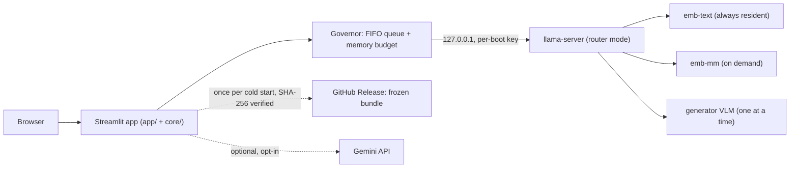

# mmrag-chat

**Multimodal RAG chat on small local models — text, images, audio and video in one embedding space — running inside the Streamlit Community Cloud free tier (≈2.7 GB RAM, ≤ 2 CPU cores, Debian 11).**

It is a working demonstration that a vision-language model, a multimodal embedder and a vector index can be *fitted* into a free shared container: a custom `llama.cpp` build serves [EmbeddingGemma-2](https://huggingface.co/google/embeddinggemma-2) (one 768-d space for text, images, audio and video frames) and a small VLM generator, with a memory governor that swaps models on demand so the whole app never leaves its budget.

## Support Us

If you find this project helpful and would like to support future projects, consider buying us a coffee! Your support helps us continue building innovative AI solutions.

[](https://www.buymeacoffee.com/blazzmocompany)

Your contributions go a long way in fueling our passion for creating intelligent and user-friendly applications.

---

<!-- RESULTS:START -->
## What it shows (measured in a 2.7 GB / 2-core emulator of the free tier)

| | |
|---|---|
| Runtime | llama.cpp `b12119` built on Debian 11 (glibc ≤ 2.30, no libstdc++ dependency, CPU kernels picked at run time) |
| Embedder | EmbeddingGemma-2 (Q4 + Q8_0 projector): one 768-d space for text, images, audio and video frames |
| Generator | LFM3-VL-2B (quantization-aware Q4_0 + Q8_0 projector), chosen from 14 candidate configurations by gated evaluation ([docs/EVALUATION.md](docs/EVALUATION.md)) |
| Memory | whole app chatting **≈ 2.0 GB (73 % of the cap)**, image question with model swap **2.06 GB (76 %)** |
| Quality (synthetic set) | 68 % of answerable questions answered correctly, 100 % of unanswerable ones refused, right source retrieved 90 % |
| Speed on 2 cores | first token in 13–15 s for text questions, ~15 s for image questions, then ~11 tokens/s; sample data (28 files, 4 modalities) indexes in < 3 min |
<!-- RESULTS:END -->

## Deploy your own copy (one click)

[](https://share.streamlit.io/deploy?repository=IA-Programming/mmrag-chat&branch=main&mainModule=streamlit_app.py)

1. **Fork** this repository (or use the button above on the original).
2. In the deploy dialog keep `streamlit_app.py` as the main file and open **Advanced settings → Python 3.11**.
3. Deploy. The first visit shows a warm-up screen while the frozen runtime and models (~2 GB, pinned by SHA-256) are downloaded from this repository's GitHub Release; afterwards the app is usable. After 12 h without visitors the app sleeps; the next visitor wakes it up (another warm-up).

**No secrets are required.** Everything optional is listed in [`.streamlit/secrets.toml.example`](.streamlit/secrets.toml.example); to use any of it, paste the filled-in TOML into your app's **Settings → Secrets** on Community Cloud (never commit a real `secrets.toml`).

| Secret | What for |
|---|---|
| `[gemini] api_key`, `model` | Optional cloud fallback generator ("bring your own key", see below) |
| `[app] enable_gemini_fallback` | Show the Gemini option without testers pasting a key |
| `[app] memory_cap_mb` | Budget the governor enforces (default 2700) |
| `[app] bundle_base_url` | Forks hosting their own bundle release |
| `[app] log_level` | DEBUG / INFO / WARNING / ERROR |

**Private testing:** in the app's **Settings → Sharing**, choose *Only specific people can view this app* and add tester emails. Access control is the platform's, not the app's.

### Bring your own key (optional Gemini fallback)

Settings → *Fallback (Gemini)* lets a tester paste a Google AI Studio key (kept only in their browser session, masked, never logged). The default model is **`gemini-3.5-flash-lite`**: on the free tier the Flash-Lite family has the most generous limits, and this version accepts text, image, audio and video (verified against the OpenAI-compatible endpoint). Only `temperature`, `top_p` and `max_tokens` are sent; controls the endpoint rejects are disabled in the UI. Rate-limit errors (HTTP 429) show a friendly message.

> **Privacy:** with the fallback enabled, prompts, retrieved text and — only after an explicit confirmation — attached media are sent to Google; on the free tier Google may use them to improve its products. Indexing and retrieval always stay inside the app.

## Using the app

| Page | What you can do |
|---|---|
| **Chat** | Ask questions about your data; attach an image or record/attach audio. Every answer shows its **sources** (score, location, preview, whether it made it into the prompt), **turn stats** (embed / retrieve / swap ms, TTFT, tok/s, token budget, peak memory) and the **effective generation parameters**. Stop button, Markdown/JSON export. |
| **Index** | Upload `.txt .md .png .jpg .webp .wav .mp3 .mp4 .webm` (≤ 50 MB each, ≤ 200 MB per session) or load the bundled sample data; watch step-level progress; export/import the index. |
| **Playground** | Matryoshka comparison (768/512/256/128 dims, overlap@k, bytes/vector), embedding knobs (chunking, image size, audio windows, video fps/frames) with a probe-set A/B, prefix A/B. |
| **Explorer** | 2-D PCA of the index colored by modality; click a point to see the item and its neighbors; overlay a query. |
| **Settings** | Models and per-model generation parameters (defaults = the model cards' recommendations), retrieval & history policy, Gemini fallback, diagnostics (environment probe JSON), danger zone. |
| **Logs** | Live structured logs of *your* session (other testers' prompts are never shown), downloads, field-report bundle for debugging. |

Your uploads, index and chat live only in your session (temporary storage, deleted after 2 h); export what you want to keep.

## How it works



* **Two phases.** Everything that needs the network or a big machine — building llama.cpp for Debian 11, downloading and evaluating candidate models, tuning — happens in a development session. The deployed app only downloads the **frozen bundle** listed in [`bundle/manifest.json`](bundle/manifest.json) (pinned by size + SHA-256) and never contacts model hubs.
* **Memory governor.** One generation (or indexing job) at a time with a visible queue; never two generators; the multimodal embedder and a generator are never resident together; models in use are never evicted; a model that would exceed the hard budget is refused with a plain message instead of crashing the app.
* **Retrieval.** Text queries use the always-resident text embedder; image/audio queries swap the generator for the multimodal embedder and back. Vectors live in a 2/4-bit [TurboVec](https://github.com/RyanCodrai/turbovec) index with a SQLite sidecar; Matryoshka truncation and the model-card prefixes are applied client-side.
* **Grounded answers.** A token-budget prompt builder includes sources in rank order (images as images when the model can see them), marks what was truncated or dropped, treats sources as untrusted data, and answers *"That is not in the indexed data."* when nothing relevant was retrieved.

More detail: [docs/ARCHITECTURE.md](docs/ARCHITECTURE.md) · model evaluation: [docs/EVALUATION.md](docs/EVALUATION.md) · contributing and the dev loop: [docs/DEVELOPMENT.md](docs/DEVELOPMENT.md).

## Run locally

```bash
python3.11 -m venv .venv && . .venv/bin/activate
pip install -r requirements.txt -r requirements-dev.txt
MMRAG_RUNTIME=fake streamlit run streamlit_app.py     # whole UI against a fake model server, no downloads
streamlit run streamlit_app.py                         # real models: downloads the frozen bundle (Linux x86-64)
```

## License

MIT for the code. Models keep their own licenses (EmbeddingGemma: Gemma terms; LFM models: LFM Open License v1.0); the synthetic sample dataset is CC0.
