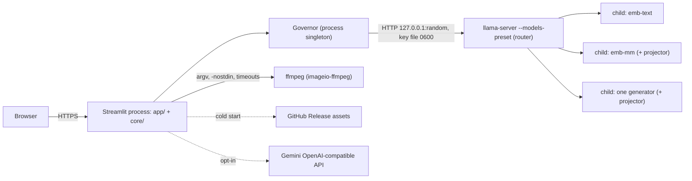

# Architecture (as built)

## Two phases, one repository

| | Development session | Deployed app (Streamlit Community Cloud) |
|---|---|---|
| Machine | 4-core x86-64, 16 GB, Docker, full network | Debian 11, glibc 2.31, ≤ 2 cores, ≤ ~2.7 GB RAM, sleeps after 12 h idle |
| Code that runs | `tools/`, `tests/`, `app/`, `core/` | `app/`, `core/` only |
| Network | Hugging Face (read token), GitHub, PyPI, Gemini | the frozen bundle's GitHub Release assets (once per cold start), optional Gemini |
| Produces | a **frozen bundle** (llama.cpp build + GGUF models) + presets + measured numbers | the app |

Rules enforced by `tests/unit/test_architecture.py`: `core/` never imports Streamlit; `app/` never starts processes or opens sockets; nothing under `app/` or `core/` imports `tools/` or `tests/`; HTTP clients are only created in `core/net.py` (host allowlist checked on every request *and* on every redirect hop); no `pickle`; subprocesses only with argv lists; no `unsafe_allow_html`.

## Repository layout

```
streamlit_app.py      entrypoint: page config, background bootstrap, navigation shell
app/                  UI (imports streamlit): shell.py, state.py (the only session_state accessor),
                      services.py (process singletons), pages/, components/
core/                 logic (no streamlit)
  net.py              egress gateway (allowlist)
  bundle/manager.py   download / resume / SHA-256 verify / atomic install / safe tar extraction
  runtime/            service.py (bootstrap), router.py (llama-server process + client),
                      governor.py, telemetry.py, presets.py (INI generation), probe.py
  embed/              preprocess.py (sniffing, per-modality preprocessing), client.py, indexer.py, probe.py
  index/              store.py (TurboVec + SQLite sidecar + float32 vectors), export_import.py
  rag/                pipeline.py, prompt_builder.py, history.py, sampling.py, export.py
  llm/backends.py     local llama-server + Gemini (OpenAI-compatible) streaming backends
  obs/                log.py (JSONL ring buffer + redaction), field_report.py
  analysis/           PCA, Matryoshka comparison, retrieval metrics
bundle/               frozen runtime config: manifest.json, model_presets.json, sampling_presets.json, embed_params.json
datasets/synth_v1/    deterministic synthetic multimodal dataset (CC0, ~8 MB) + ground truth
tools/                dev only: llama/ (build, smoke tests), fetch_models.py, release.py, eval/, dataset/, replay.py
docker/               Dockerfile.build (Debian 11 toolchain), Dockerfile.runtime + compose.cap.yml (capped emulator)
experiments/          ledger.jsonl (append-only record of every measurement and decision)
tests/                unit/, apptest/ (fake llama-server), integration/ (real build), fakes/
```

## Runtime topology



Router flags (verified with `llama-server --help` of b12119): `--host 127.0.0.1 --port <random> --api-key-file <0600 file> --models-preset <ini> --models-max 3 --no-models-autoload --no-webui`. Per preset: `ctx-size`, `threads`/`threads-batch` = 2, `batch-size`/`ubatch-size`, `cache-type-k/v`, `parallel = 1`, **`cache-ram = 0`** (the default 8 GiB host prompt cache would grow outside the budget), **`load-mode = none`** (see below), `no-warmup`, `stop-timeout = 5`. Models are unloaded explicitly (`POST /models/unload`); idle sleep is not relied on.

### Why `load-mode = none`

With the default mmap loading, Q4_0 weights are repacked into anonymous memory for the AVX2/AVX-512 kernels **while the mapped file stays resident**, so the weights count twice: LFM3-VL-2B used 2.10 GB RSS. Loading without mmap keeps the repacked copy only: 1.34 GB at the same prefill/decode speed (ledger `EXP-LOAD-MODE-01`).

## Bootstrap

1. `get_runtime()` (cached once per process) starts a background thread; every page shows the warm-up screen (per-asset progress) until it is ready; Settings/Logs stay usable.
2. For each asset in `bundle/manifest.json`: if a `.verified` marker (sha256, size, mtime) matches, skip; else download with HTTP Range resume to `.part`, verify size + SHA-256, retry once, atomically rename. A failure names the asset and the expected hash.
3. Extract the runtime tarball (no absolute paths, no `..`, no links escaping the target, no devices), `chmod +x llama-server`.
4. Write the presets INI, start the router, wait for `/health`, load `emb-text`.

## Governor (model residency)

* **Tickets:** one holder at a time (a chat turn, an indexing job, a playground probe); others wait FIFO with a visible queue position and can cancel; 120 s timeout.
* **Rules:** never two generators; `emb-mm` never co-resides with a generator; a model with use count > 0 is never evicted; eviction order when memory is short: idle generator → idle `emb-mm` → `emb-text`.
* **Budget:** need = measured peak (else the preset estimate); refuse with a plain message if nothing evictable makes room; after a load, if real usage exceeds 95 % of the cap, unload again and report the numbers.
* **Media query swap:** unload generator → load `emb-mm` → embed the query → unload `emb-mm` → reload the generator (each step timed and shown in the turn stats).

## Chat turn

validate attachment → ticket → (optional `llm_rewrite`: exactly one extra call) → embed query (text: `emb-text`; media: swap) → TurboVec top-k with threshold and per-modality quota → history policy (`full` / `window(N)` / `none`) → **prompt budget builder** (system + query + ≤ 35 % history + sources in rank order; media the generator cannot take falls back to its sidecar text or metadata; the user's attachment goes *first* — `EXP-PROMPT-01`) → ensure generator → stream (`st.write_stream`; Stop closes the HTTP stream so decoding stops server-side) → stats, sources, effective parameters.

## Index

TurboVec `TurboQuantIndex` (2 or 4 bits/coordinate; ~196 / 388 bytes per 768-d vector) + SQLite sidecar (`source`, `item`, `meta`; parameterized queries) + optional float32 vectors for the Playground/Explorer. Invariant: item count == TurboVec count == vector rows. Export is a zip with a manifest (fingerprint, dim, bits, member SHA-256); import refuses mismatched fingerprints/dimensions/schemas, path traversal, zip bombs and never unpickles.

## Decisions (ADRs, with the evidence in `experiments/ledger.jsonl`)

| ID | Decision |
|---|---|
| ADR-001 | Two phases + frozen bundle pinned by SHA-256; the deployed app never discovers models. |
| ADR-002 | Custom llama.cpp: Debian 11 container, **clang 18** (gcc 10 cannot build the AVX-VNNI variants), static libstdc++/libgcc, `GGML_BACKEND_DL` + all CPU variants, **OpenMP off** (no `libgomp` dependency). Allowlisted patch queue: empty (PR 22284 triaged — no failing test needs it). |
| ADR-003 | Router-mode llama-server + governor + explicit unload. |
| ADR-004 | Fixed embedder EmbeddingGemma-2 UD-Q4_K_XL + mmproj Q8_0 as two presets (`emb-text`, `emb-mm`); text vectors are identical in both. |
| ADR-005 | TurboVec behind a `VectorStore` protocol, numpy twin for parity tests. |
| ADR-006 | `st.navigation` (EXP-UI-01: 1 vs 6 page bodies per rerun, p95 24 vs 51 ms); the tabs shell was deleted. |
| ADR-007 | Own thin OpenAI-compatible client on httpx for local and Gemini (llama.cpp extension fields, small import footprint). |
| ADR-008 | No server-side persistence: session-only state, user-held exports. |
| ADR-009 | ffmpeg from `imageio-ffmpeg` (static 7.0.2, runs on Debian 11). |
| ADR-010 | PCA via numpy SVD (no scikit-learn/UMAP). |
| ADR-011 | Matryoshka truncation + prefixes client-side. |
| ADR-012 | Logs are session-scoped; the ring buffer is process-global, so every event carries a session id. |
| ADR-013 | Sampling defaults are data with provenance (`bundle/sampling_presets.json`, verified by `tools/verify_sampling_presets.py`). |
| ADR-014 | `load-mode none` for every preset (EXP-LOAD-MODE-01). |
| ADR-015 | Synthetic speech via espeak-ng (offline, deterministic; GPL tool, CC0 output). |
| ADR-016 | Gemini default `gemini-3.5-flash-lite` (EXP-GEMINI-01). |
| ADR-017 | Text chunks of 128 tokens without overlap (EXP-EMB-01); generator images capped at 128 tokens (EXP-VIS-01); prefill (~50 tok/s on 2 cores) drives both. |
| ADR-018 | Shipped generator LFM3-VL-2B QAD Q4_0 (S12, docs/EVALUATION.md). |
| ADR-019 | History `window(4)` + `llm_rewrite` contextualization by default (EXP-HIST-01); skipped when the policy is `none`. |
